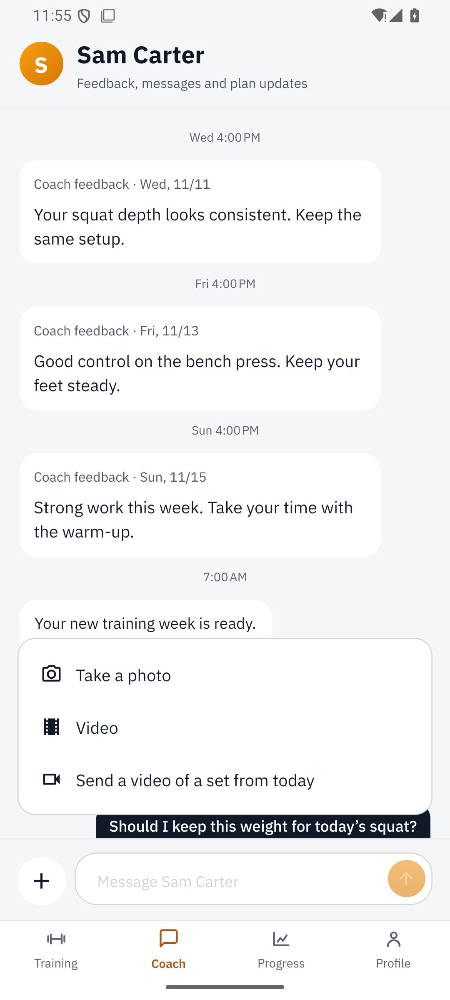
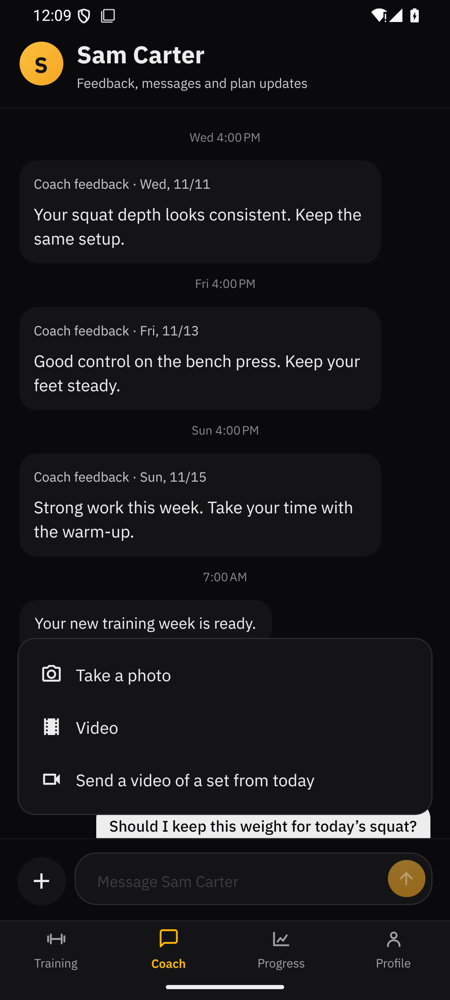
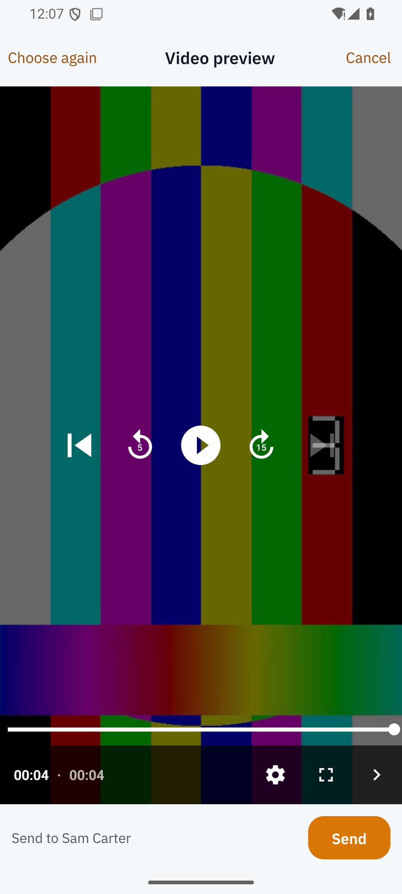
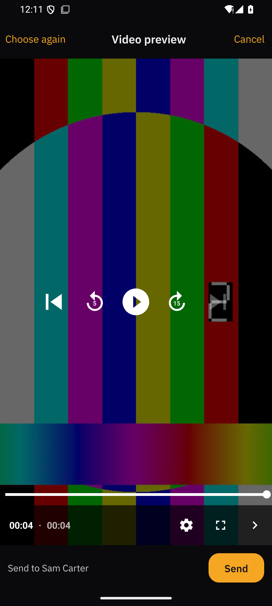

# 113 Android 验证证据

代码基底 `8995895`，完整过程见 [JOURNAL](../../journal/2026-11-17-113-android.md)。[红绿与定向回归原始摘要](red-green.txt) 包含 outbox / 历史确认、三语文案、既有 route coachId、固定 wire body 的失败复现及通过结果。

- 学员、实时、旧组分享入口：3 suites / 86 tests 通过。
- 三语、picker、demo 文件副本与 demo transport：4 suites / 16 tests 通过。
- wire API 与 no-literal-zh 精确协议豁免 guard：2 suites / 4 tests 通过。
- 教练接收/精确续签与 transfer 清理：2 suites / 25 tests 通过。
- outbox：5 tests 通过；最终 tsc、目标 eslint、diff whitespace 检查通过。
- 独立 Standards / Spec 第一轮定向复审：CLEAN。独立 Spec 第二轮确认真实 picker 修复，并提出 demo 清理 P2；根代理根据复现、最终代码及 27 项 green 定向核实关闭，未宣称又跑第三轮独立审查。

以上计数存在用例重叠，不相加作为全量测试数。全量 Jest 启动后遇共享环境磁盘压力，被停止；没有宣称全量通过。

原生 QA 使用既有 AVD `meetpr`、emulator-5572，独立包 `com.meetpr.global.chatvideoqa`，Metro 8096，Global + demo。测试视频是本机生成的 4 秒 MP4。demo 只验证 UI/原生解码，不代表真实后端或对象存储收发成功。真实账号收发、重新拉取持久化、弱网/跨端与升级验收待部署授权后完成。

## 原生验收结果

[构建/安装/启动证据](native-build.txt)、[既有播放器 patch 的隔离应用证据](player-patch.txt)、[原生崩溃 red](native-preview-red.txt)、[最终预览/重选/取消与 demo 回播结果](native-preview-green.txt)。

| 浅色菜单 | 深色菜单 |
|---|---|
|  |  |

| 浅色预览 | 深色预览 |
|---|---|
|  |  |

[系统单选视频入口](native-picker.png) · [demo 确认卡片](sent-demo-dark.png) · [demo 卡片回播](playback-demo-dark.png)。卡片缺远端 poster/duration 时按 spec 显示可播占位，不伪造时长；预览真实本地时长为 4 秒。

最终新增 race / cleanup 回归：5 suites / 27 tests 通过，包含延迟副本、登出晚到、部分写入失败、reset 晚到和 ID 复用保护。旧聊天/三语/协议回归结果见上；不累加重叠计数。
